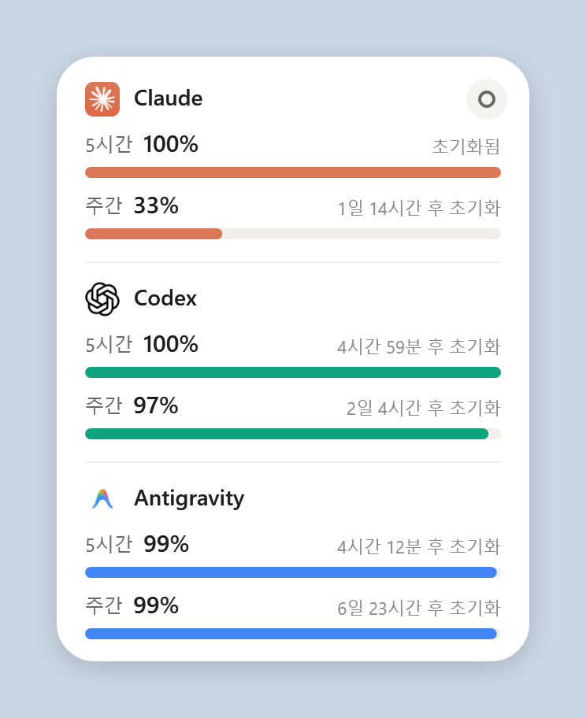
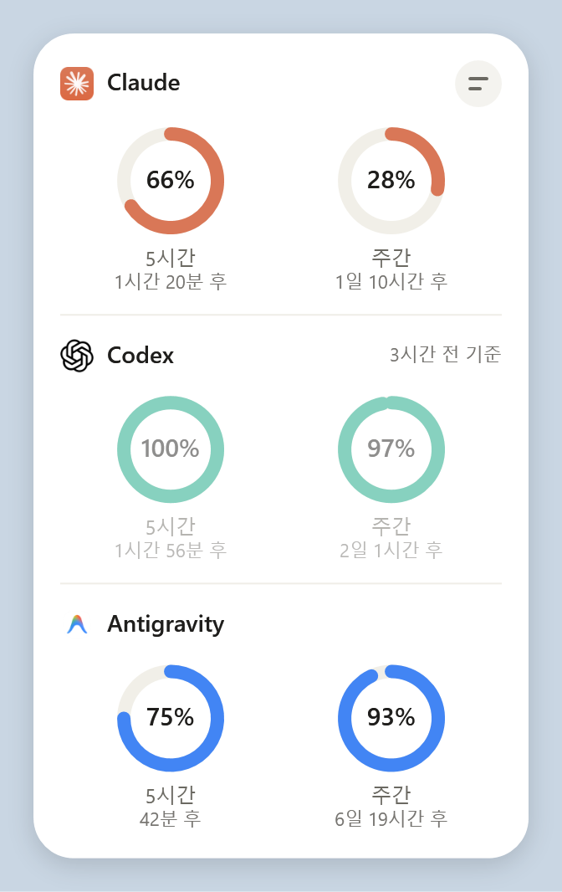
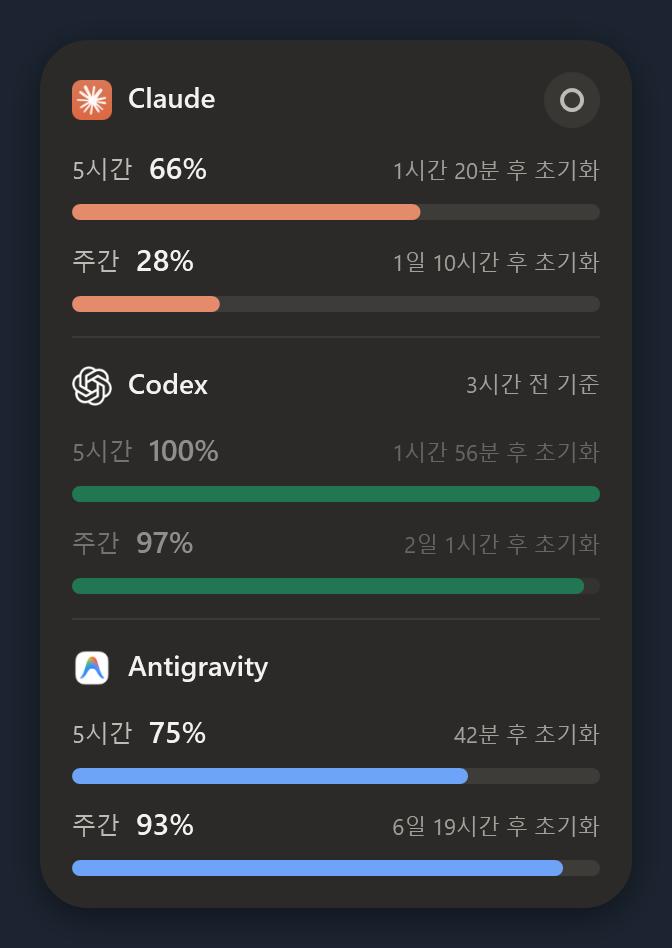
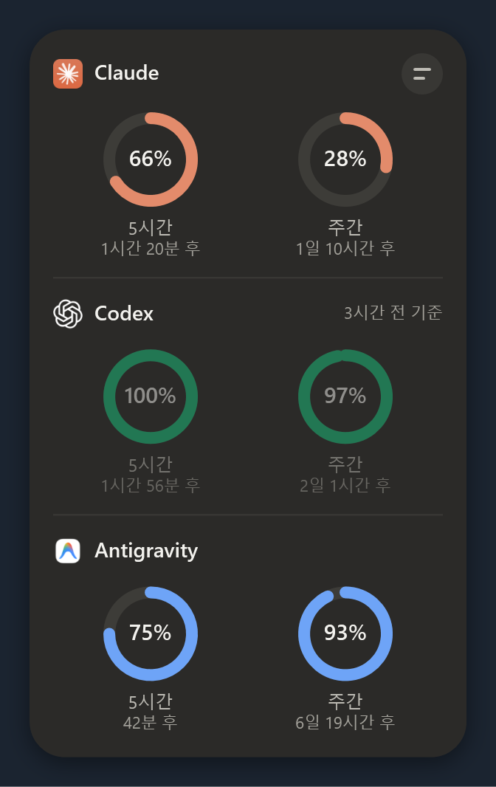

# Windows AI Usage Widget

A small, rounded desktop widget for Windows that shows how much of your **Claude**, **OpenAI Codex**, and **Google Antigravity** usage limits are left — the 5-hour window and the weekly window — and when each one resets.

Built on [BWUI](https://github.com/byeonggwan/bwui), a small design system for Windows desktop widgets.

| Bars | Rings |
|---|---|
|  |  |
|  |  |

- Shows **remaining** percentage for the 5-hour and weekly limits, plus time until reset.
- One click (top-right button) switches between the bar and ring layouts; the choice is remembered.
- At 20% or less a value turns amber with a ⚠ mark, and at 5% or less red with an ⓧ mark, so the status doesn't rely on color alone.
- Shows "as of N min ago" when data is out of date, and dims it once it's too old to trust; it never hides it.
- Sits on the desktop behind your windows, hidden from the taskbar and Alt+Tab. Drag it anywhere; the position is remembered.
- Light, dark and High Contrast themes. It follows Windows by default; right-click → Theme to pin one.
- Right-click: switch layout, show or hide each service, refresh now, theme, start with Windows, quit. A hidden service is not fetched at all.
- Sharp on every monitor: it's per-monitor DPI aware.
- Adapts to your plan: a window your plan doesn't have (for example no 5-hour limit) is not drawn, and a plan without these limits says so ("No usage limit").
- Lightweight: about 60 MB of memory, almost no CPU. On battery it refreshes half as often. No installer, no runtime to download — it is built with the C# compiler that ships with Windows.
- Updates itself from this repo's GitHub Releases, only through the right-click menu (never on the widget itself). **Check for updates** compares your version with the latest release; if it's newer, click **Install update**, which checks the SHA-256, swaps the exe and restarts. Check **Update automatically** to have it check daily and install without asking.
- **Never reads, stores, or refreshes login tokens.** It only reads numbers that the official Claude and Antigravity tools already produce.

> Labels follow your Windows display language: Korean, or English for everything else. The screenshots are in Korean (`5시간` = 5-hour, `주간` = weekly, `후 초기화` = until reset).

## Requirements

- Windows 10 or 11 with .NET Framework 4.x (preinstalled on Windows 10/11)
- For Claude: the [Claude desktop app](https://claude.ai/download) (Code tab and scheduled tasks), or Claude Code CLI
- For Codex: the Codex CLI installed with npm (`npm i -g @openai/codex`) or the Codex desktop app running, signed in
- For Antigravity: the Antigravity CLI `agy` at `%USERPROFILE%\.gemini\bin\agy.exe`, signed in

You only need the ones you use; hide the others from the right-click menu.

## Install

```powershell
git clone https://github.com/byeonggwan/windows-ai-usage-widget.git
cd windows-ai-usage-widget
powershell -ExecutionPolicy Bypass -File .\build.ps1
Start-Process "$env:LOCALAPPDATA\AiUsageWidget\AiUsageWidget.exe"
```

`build.ps1` compiles two programs and copies them to `%LOCALAPPDATA%\AiUsageWidget`:

| File | What it does |
|---|---|
| `AiUsageWidget.exe` | The desktop widget |
| `AiUsageStatus.exe` | Optional Claude Code status line handler (see below) |

If the Claude or Codex desktop app is running during the build, its icon is copied for the widget; otherwise a colored square is shown. Antigravity's icon is read from `Antigravity.exe` at runtime. No logos are included in this repository.

To start the widget with Windows, right-click it and check **Start with Windows** (**Windows 시작 시 실행**), or run:

```powershell
Set-ItemProperty 'HKCU:\Software\Microsoft\Windows\CurrentVersion\Run' -Name AiUsageWidget -Value "`"$env:LOCALAPPDATA\AiUsageWidget\AiUsageWidget.exe`""
```

## Where the numbers come from

### Codex

Every 5 minutes the widget starts `codex app-server` (Codex's official JSON-RPC interface over stdio), sends `initialize` and `account/rateLimits/read`, and closes it. Codex uses its own sign-in; no model is called. The `primary` window (300 minutes) is shown as 5-hour and the `secondary` window (10080 minutes) as weekly.

The widget looks for `codex.exe` from the npm package first, then for the one bundled with a running Codex desktop app.

### Antigravity

Every 5 minutes the widget runs the official CLI command:

```
agy -p /usage
```

It is answered by the CLI itself (no model call) and prints the remaining 5-hour and weekly quota per model group. The widget shows the **Gemini** group. Antigravity's separate "Claude and GPT models" group is hidden. If your plan reports no Gemini group, every group is shown with its name.

### Claude

Claude's plan limits are not written to disk by any official tool, so pick one of these sources. The widget uses whichever one is newer.

**Option A — Claude desktop app scheduled task (recommended if you mostly use the desktop app)**

A scheduled task in the Claude desktop app reads your plan usage and saves it to `%LOCALAPPDATA%\AiUsageWidget\claude-app.json`. It uses the app's own sign-in, so it stays connected as long as the app does. Set it up once on each PC:

1. Right-click the widget and choose **Connect Claude** (**Claude 연결 설정**). A setup message is copied to the clipboard.
2. Paste it into a new chat in the Claude desktop app and send it. Claude creates the task (hourly from 08:00 to 23:00, on a Haiku model) and runs it once.

To set it up by hand instead, use the prompt in [`scheduled-task/claude-limits-task.md`](scheduled-task/claude-limits-task.md).

- An hourly schedule is enough: the widget marks Claude numbers stale only after 75 minutes.
- Each run is a short Claude session, so it uses a little of your plan usage. In testing, one run took about 8 seconds and did not move the usage percentage.
- Runs only happen while the desktop app is open.
- The app delays recurring runs by a few minutes to spread load (the task list shows the delay).
- Until a source is set up, the widget shows **Claude isn't connected** instead of numbers.

**Option B — Claude Code CLI status line**

If you use Claude Code in a terminal, point its status line at the handler in `~/.claude/settings.json`:

```json
"statusLine": {
  "type": "command",
  "command": "C:/Users/<you>/AppData/Local/AiUsageWidget/AiUsageStatus.exe"
}
```

Claude Code passes `rate_limits` to the status line. The handler saves them to `claude.json` for the widget and prints a short line such as `Opus 5.5 · 5시간 72% · 주간 58% 남음`. This updates only while the CLI is running, and Claude Code documents `rate_limits` for Pro and Max subscribers. The Claude desktop app's Code tab does not run status line commands.

If you already use a status line, keep a backup of your `settings.json` before replacing it.

## Files

```
Widget.cs                          The widget (layout, menu, refresh timers)
Data.cs                            Data sources: Claude files, Codex app-server, agy
BWUI/                              Vendored BWUI design system (see BWUI/VERSION)
StatusLine.cs                      Claude Code status line handler
build.ps1                          Build and install to %LOCALAPPDATA%\AiUsageWidget
scheduled-task/claude-limits-task.md   Prompt for the Claude desktop app scheduled task
```

Data and settings live in `%LOCALAPPDATA%\AiUsageWidget`:

| File | Written by |
|---|---|
| `claude-app.json` | Claude desktop app scheduled task |
| `claude.json` | `AiUsageStatus.exe` (Claude Code status line) |
| `codex.txt` | The widget (last Codex rate-limit response) |
| `antigravity.txt` | The widget (last `agy -p /usage` output) |
| `settings.txt` | The widget (layout, position, theme, shown services) |

Preview without showing the window:

```powershell
& "$env:LOCALAPPDATA\AiUsageWidget\AiUsageWidget.exe" --snapshot preview.png light        # or: dark, and add "ring" for the ring layout
```

## Uninstall

1. Right-click the widget and choose **종료** (quit).
2. Remove the startup entry: `Remove-ItemProperty 'HKCU:\Software\Microsoft\Windows\CurrentVersion\Run' -Name AiUsageWidget`
3. Delete `%LOCALAPPDATA%\AiUsageWidget`.
4. Remove the scheduled task in the Claude desktop app and the `statusLine` entry in `~/.claude/settings.json`, if you added them.

## Limitations

- Windows only.
- Relies on the output format of `agy -p /usage`, Codex's `account/rateLimits/read`, and the Claude desktop app's usage tool. If any of them changes, that section may show `—` or go stale until the widget is updated.
- Claude numbers can be up to one schedule interval old.
- Tested on a Claude Team plan, a ChatGPT Plus plan (Codex), and an Antigravity personal plan. Other plans are handled from each tool's reported windows but haven't been tested; issues and pull requests are welcome.

## Disclaimer

This is an unofficial community project. It is not affiliated with or endorsed by Anthropic, OpenAI, or Google. Claude is a trademark of Anthropic. Codex and ChatGPT are trademarks of OpenAI. Antigravity and Gemini are trademarks of Google.

## License

[MIT](LICENSE)
